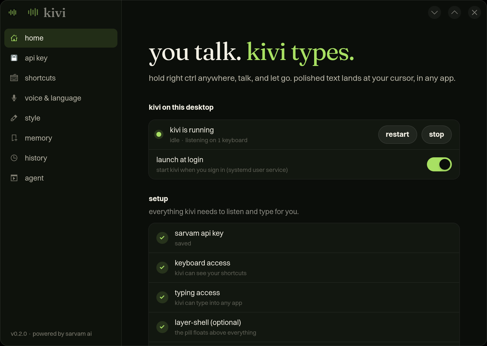
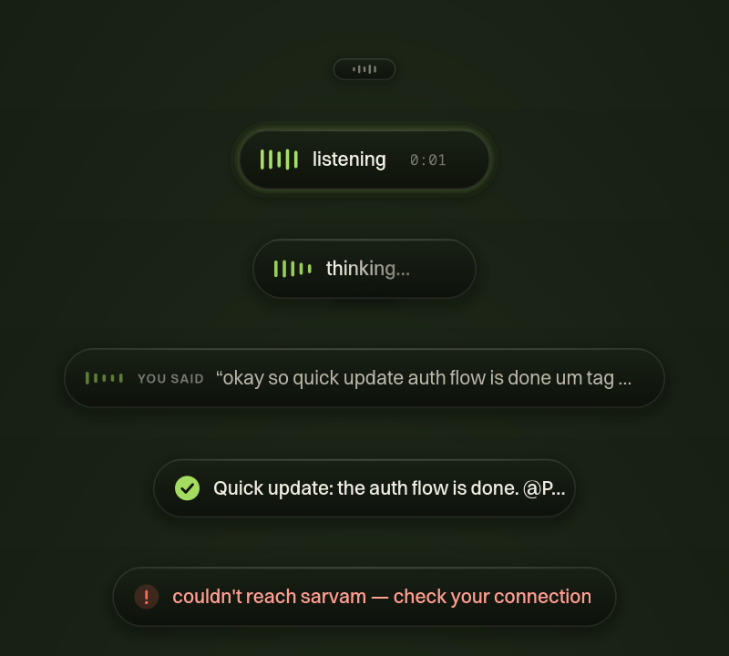
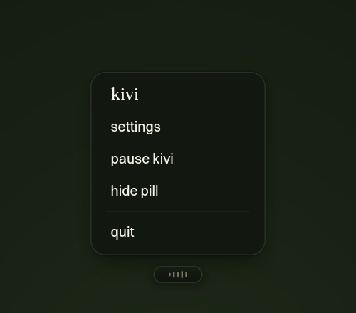
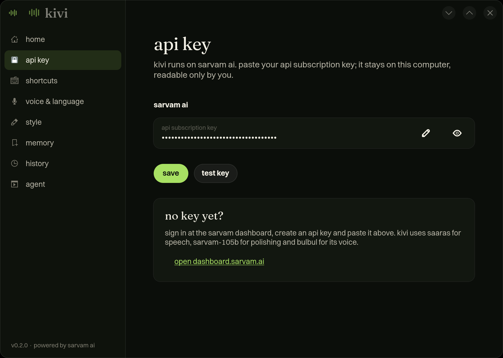
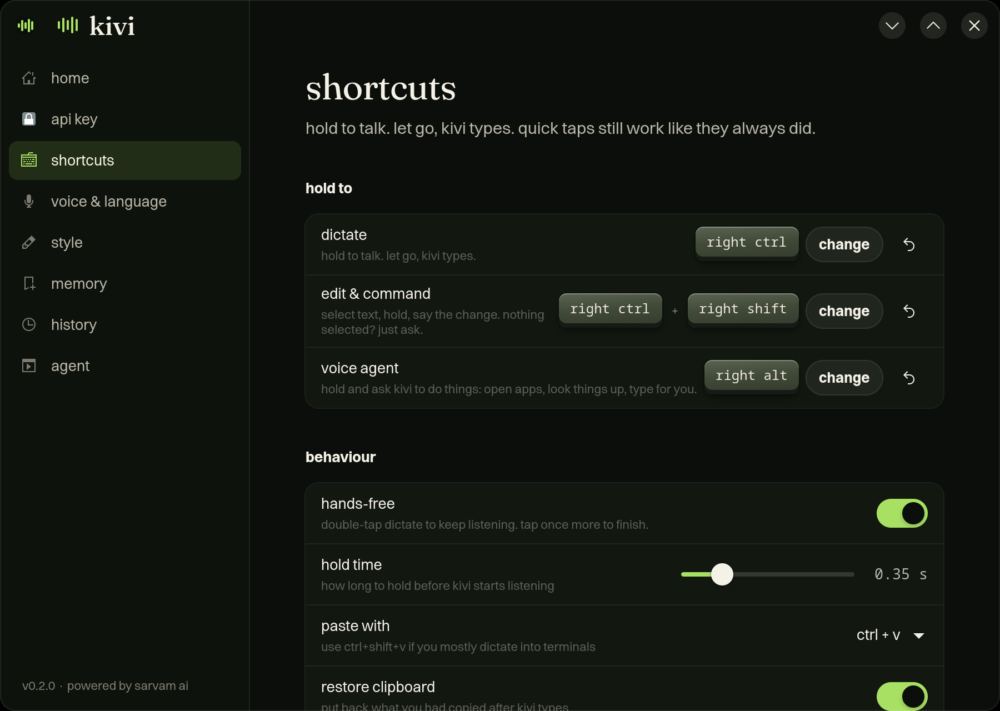
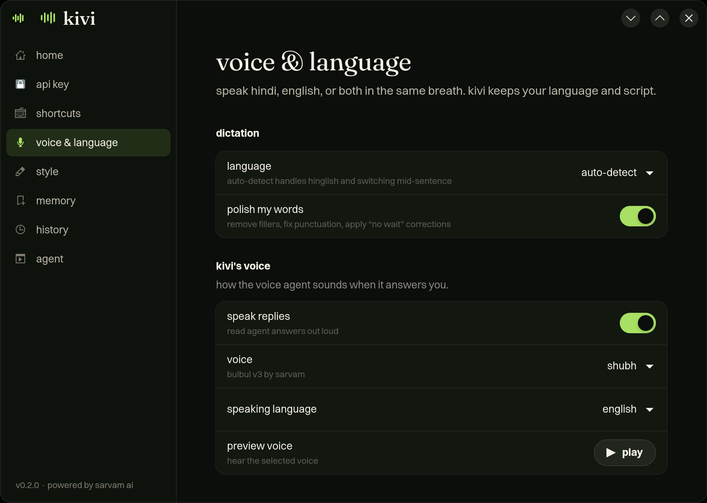
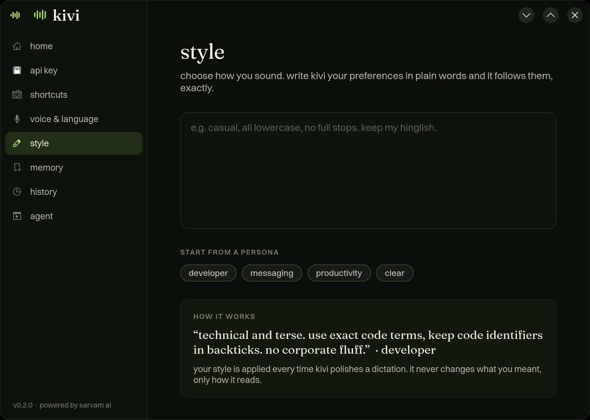
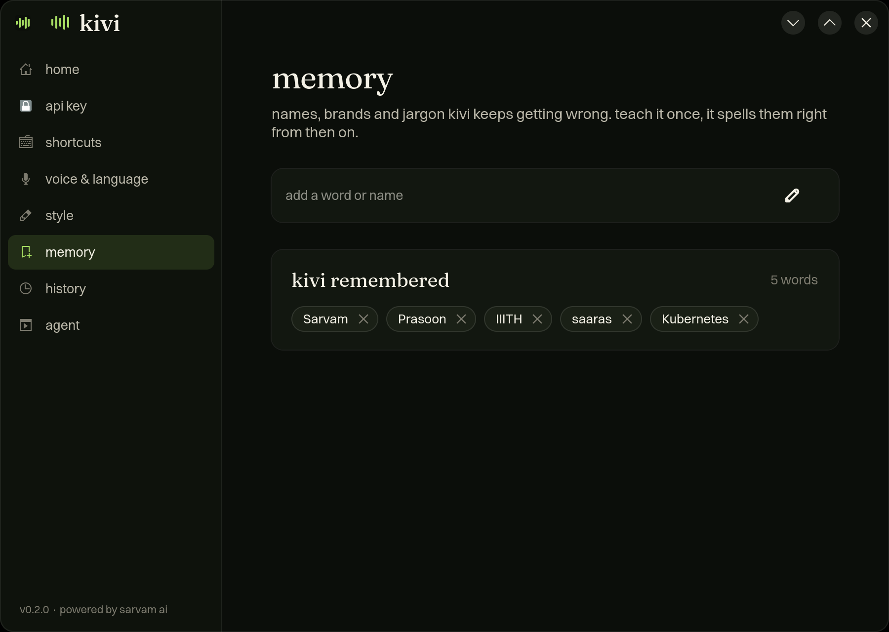
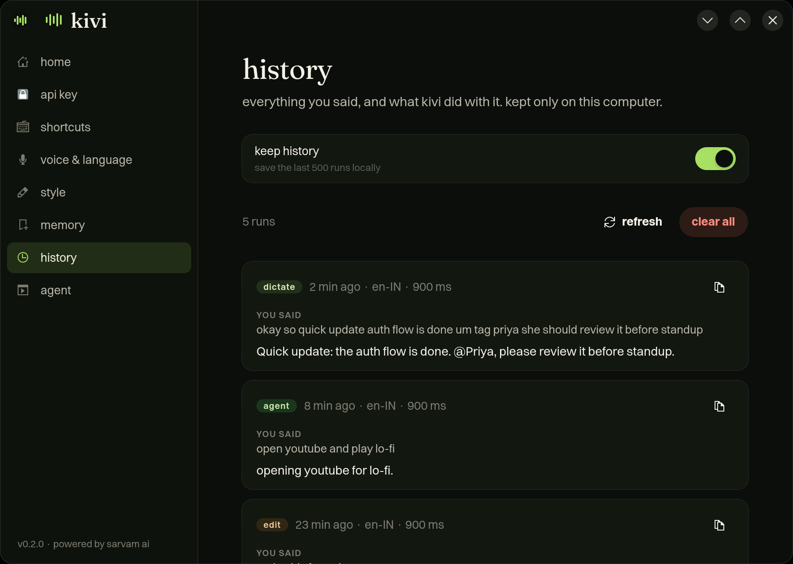
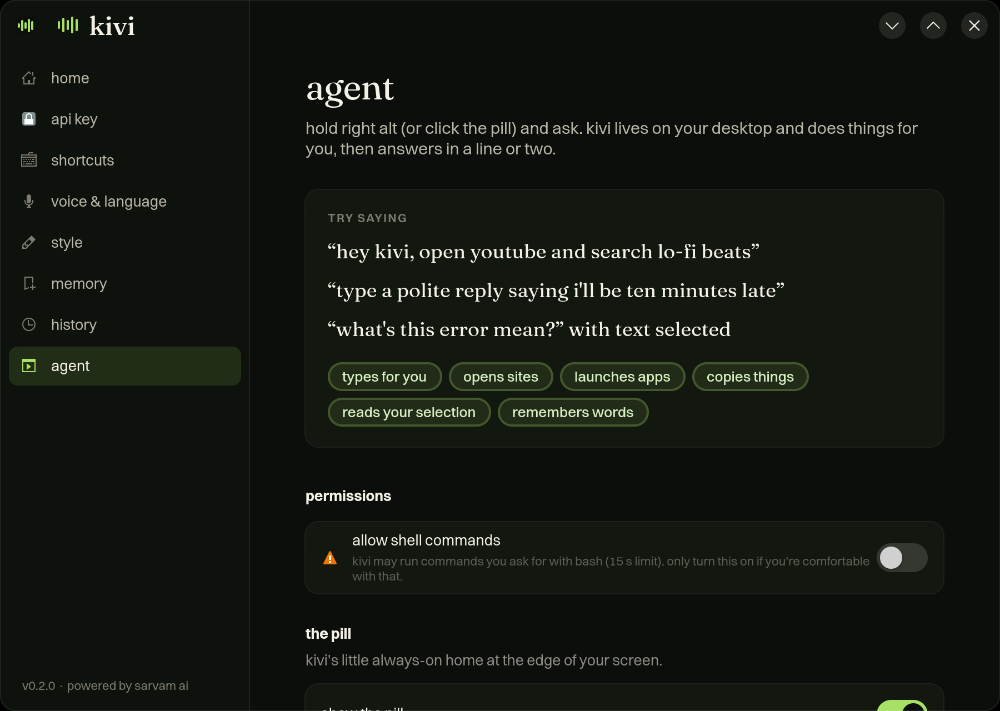

# kivi-linux

you talk. kivi types.

[Kivi](https://heykivi.ai) isn't available for Linux, so this tries to mirror it, powered by
[Sarvam AI](https://sarvam.ai). Hold a key, speak, let go, and clean text lands in whatever app has
focus. It works in Hindi, Hinglish, English and the other Indian languages `saaras:v4` understands.
A small pill sits on your desktop and shows you what kivi is doing. It also hosts a voice agent that
can open things and type for you.

<p align="center">
  
</p>

## what it does

| hold | kivi |
|---|---|
| **right ctrl** | **dictate.** filler words go, punctuation gets fixed, "at five, no wait, six" becomes "at six". Then it's pasted. |
| **right ctrl + right shift** | **edit.** select text and say "make this formal" or "turn into bullets". The selection is replaced. With nothing selected, kivi answers your question in a card. |
| **right alt** | **voice agent.** "open youtube", "launch firefox", "type a polite no to this email", "remember the word Sarvam". It answers out loud. |

- **double-tap** right ctrl for hands-free: kivi keeps listening until you tap again.
- **click the pill** to talk to the agent, and click again to send. Right-click it for settings, pause and quit.
- a quick tap, or right ctrl used inside a shortcut like ctrl+c, never starts dictation.
- **memory**: teach kivi names and jargon (`kivi add-word Prasoon`, or the memory page). They're sent to
  speech-to-text as key terms.
- **style**: set a persona, such as "technical and terse" or "casual, all lowercase".
- **history**: every run is saved locally so you can copy it again later.

All of these can be changed in **kivi settings** (app menu → kivi).

## ui

The look follows Kivi's: the dark "dusk" palette (`#0b0e0a` background, cream `#f4f1e6` text), the
green `#a8e063` listening bars, **Fraunces** for headings, **Switzer** for body text, and lowercase
copy throughout.

### the pill

kivi's always-on face. It sits at the bottom centre of your screen, above every window, and never takes
keyboard focus, so your text still lands in the app you were using. On KDE it uses `gtk4-layer-shell`,
and falls back to a KWin script if that isn't installed.

<p align="center">
  
</p>

From top to bottom: **idle** (a small dim pill), **listening** (the bars move with your voice, with a
timer), **thinking**, **you said** (the raw transcript), **done** (the cleaned text that was typed),
and **error**.

<table>
  <tr>
    <td></td>
    <td></td>
  </tr>
  <tr>
    <td>The agent and ask mode answer in a card above the pill, with copy and dismiss. With
    <code>agent_speak</code> on, kivi also reads the answer aloud in a Bulbul v3 voice.</td>
    <td>Right-click the pill for settings, pause, hide and quit.</td>
  </tr>
</table>

### kivi settings

A GTK4 / libadwaita app for managing kivi. There's no sign-in: you paste your own Sarvam API key and
it stays on your machine.

<table>
  <tr>
    <td><br><b>home</b>: whether kivi is running, start/stop, launch at login, and a setup checklist that gives the exact command for anything missing.</td>
    <td><br><b>api key</b>: paste and test your Sarvam key, in place of signing in.</td>
  </tr>
  <tr>
    <td><br><b>shortcuts</b>: press the keys you want to record a new shortcut. Also hands-free, hold time and the paste key.</td>
    <td><br><b>voice & language</b>: auto-detect or pick from 23 languages, polishing on/off, and the agent's voice, with a preview.</td>
  </tr>
  <tr>
    <td><br><b>style</b>: describe how you write in plain words, or start from the developer, messaging or productivity persona.</td>
    <td><br><b>memory</b>: "kivi remembered", the names and jargon kivi now spells right.</td>
  </tr>
  <tr>
    <td><br><b>history</b>: what you said next to what kivi did with it, kept only on your machine.</td>
    <td><br><b>agent</b>: what the voice agent can do, an opt-in switch for shell commands, and pill placement.</td>
  </tr>
</table>

## install

```sh
./install.sh
```

This links `kivi` into `~/.local/bin`, adds the app icon and menu entry, and starts the `kivi` systemd user
service. When it finishes it prints the one `sudo` line you still need (if any), usually:

```sh
sudo pacman -S --needed gtk4-layer-shell wl-clipboard && sudo usermod -aG input $USER
```

The `input` group lets kivi see your hotkeys. Log out and back in after joining it, or run
`sudo setfacl -m u:$USER:rw /dev/input/event*` to get access now (it lasts until reboot). Without
it, kivi still works through the pill or `kivi toggle`, which you can bind to any shortcut in system settings.
`gtk4-layer-shell` is optional and gives a cleaner always-on-top pill. `wl-clipboard` is optional too.

Put your Sarvam API key in **kivi settings → api key**. It's stored in `~/.config/kivi/api_key` (chmod 600).
You can also set `$SARVAM_API_KEY`.

Requirements: KDE Plasma 6 on Wayland is the main target. X11 and GNOME work with a plainer pill.
You also need pipewire, python-evdev, gtk4 and libadwaita.

## command line

```
kivi                      run the daemon (the service does this for you)
kivi settings             open the settings window
kivi toggle [dictate|agent|command]
kivi add-word WORD        teach kivi a word
kivi words                list learned words
kivi test FILE.wav        speech-to-text + cleanup on a file, without typing anything
kivi status               is it running, and is everything set up
```

Logs: `journalctl --user -u kivi -f`.

## config

`~/.config/kivi/config.toml`. Settings writes it for you; every key is listed in
[`config.example.toml`](config.example.toml).

## how it works

evdev hotkeys (works on any compositor) → `pw-record` at 16 kHz → Sarvam `speech-to-text` (saaras:v4) →
`sarvam-105b-conversations` cleanup with reasoning off → kivi puts the text on the clipboard, a virtual
uinput keyboard presses ctrl+v, and your old clipboard comes back. Expect about a second from letting
go to seeing text. The agent uses Sarvam chat with tools, and speaks through `bulbul:v3`.

## limits

- Sarvam's synchronous speech-to-text takes clips up to about 30 s, so kivi stops listening at 29 s.
- Terminals want `paste_keys = "ctrl+shift+v"`. Per-app paste keys aren't supported yet.
- Clipboard managers will see each dictation.
